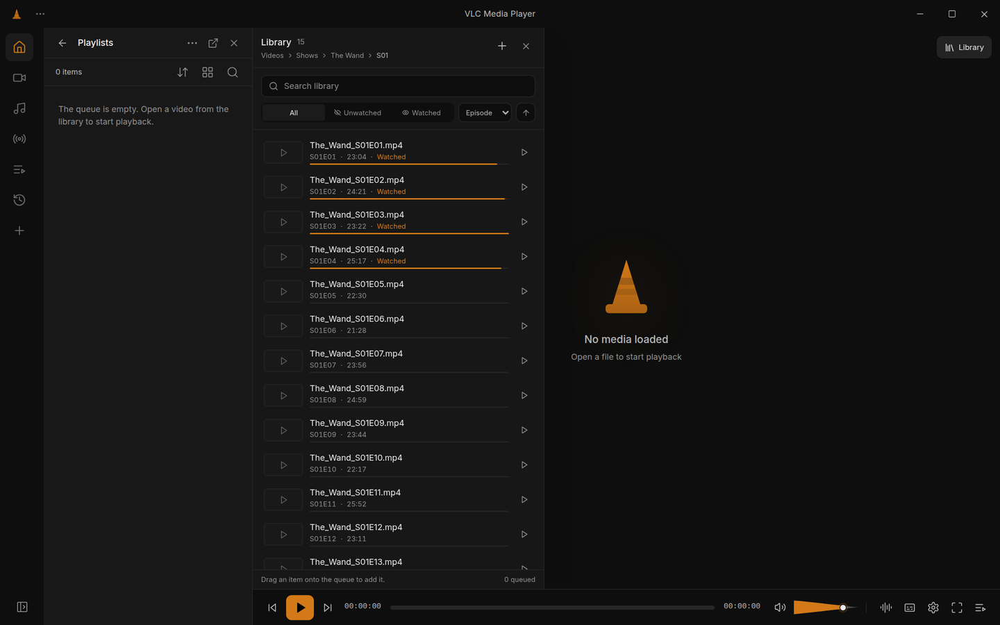
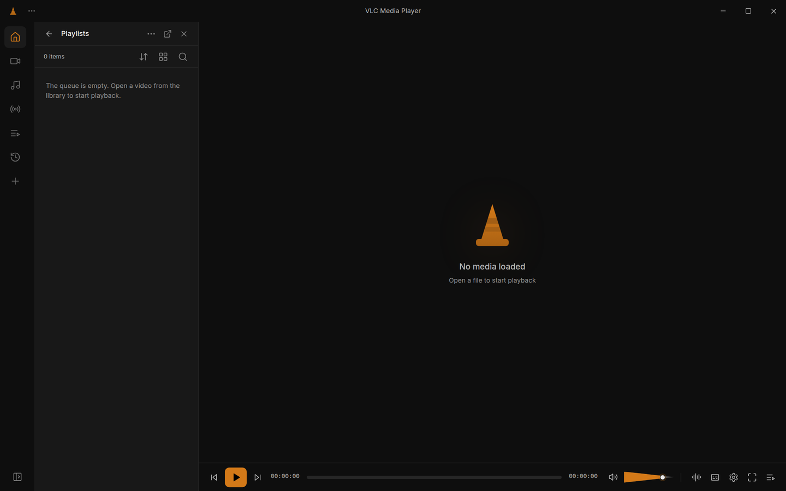
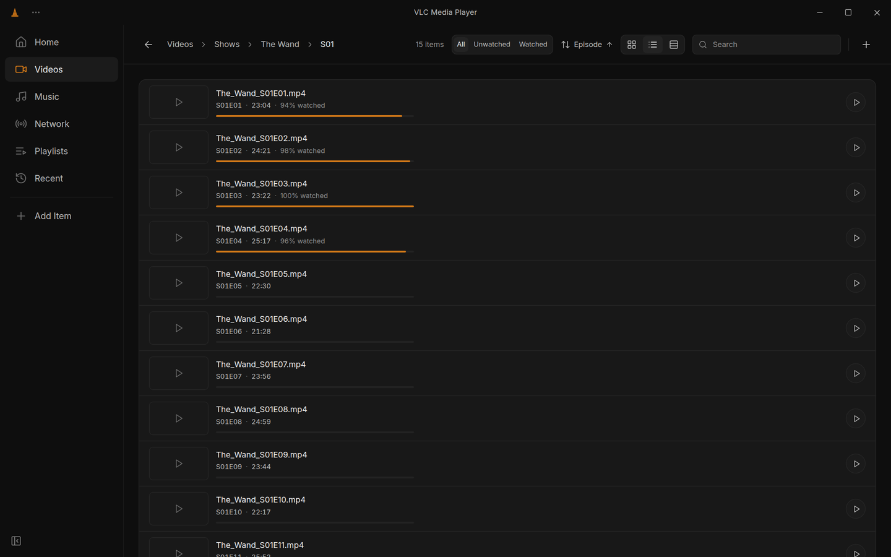
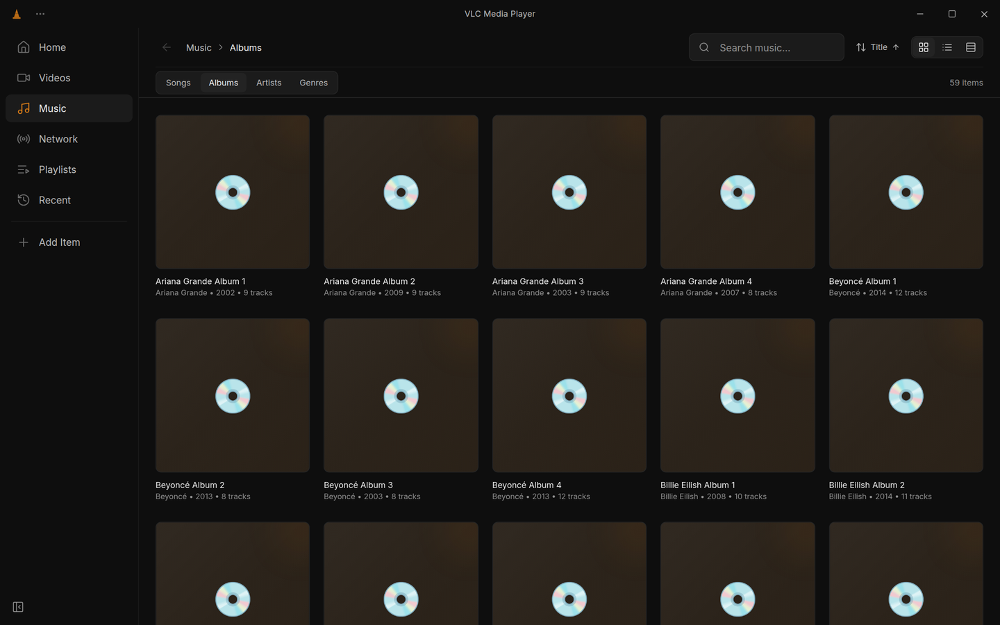
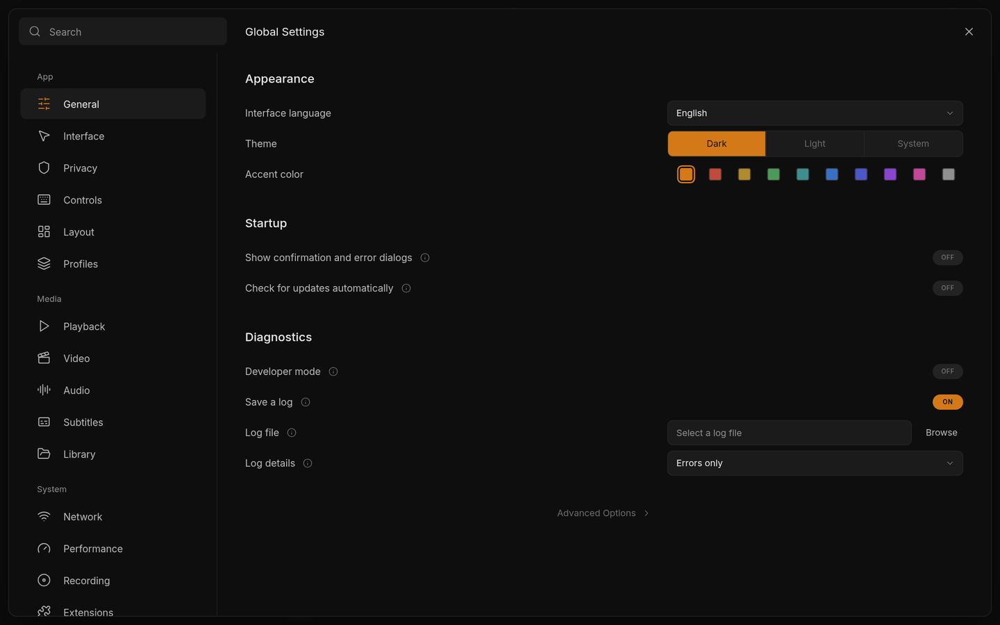
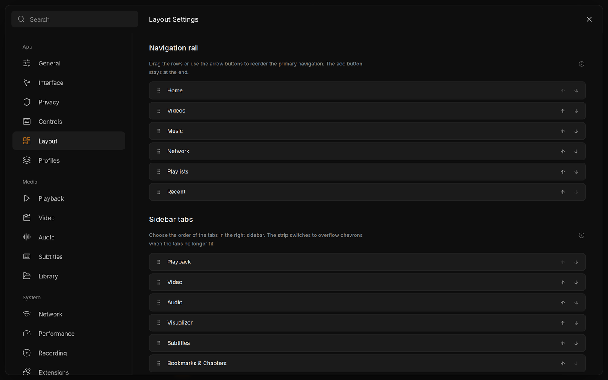
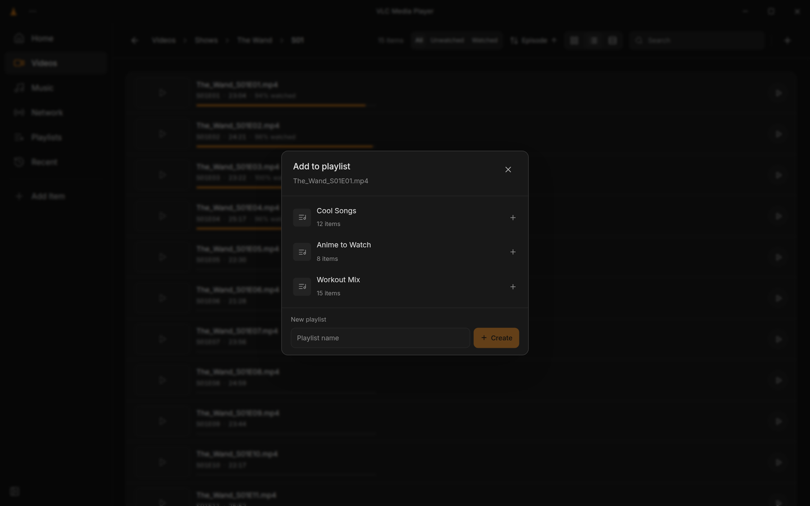
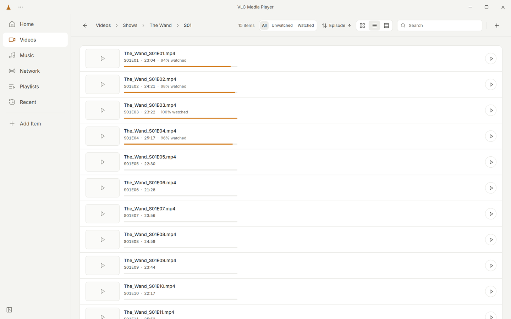

<div align="center">


<h1>VLC Redesign (Community)</h1>

<p><strong>A community-built VLC Media Player desktop interface.</strong><br />
Orange cone, neutral gray surfaces, softened rectangular corners, and a dual dark/light theme.</p>

<p>
  <a href="https://github.com/quabynahdavis/vlc-svelte/releases"></a>
  <a href="https://github.com/quabynahdavis/vlc-svelte"></a>
  <a href="https://tauri.app"></a>
  <a href="https://svelte.dev"></a>
  <a href="https://www.typescriptlang.org"></a>
  <a href="https://tailwindcss.com"></a>
  <a href="https://bun.sh"></a>
</p>

<p>
  <a href="https://github.com/quabynahdavis/vlc-svelte/stargazers"></a>
  <a href="https://github.com/quabynahdavis/vlc-svelte/forks"></a>
  <a href="https://github.com/quabynahdavis/vlc-svelte/issues"></a>
  <a href="https://github.com/quabynahdavis/vlc-svelte/commits/main"></a>
  <a href="README.md"></a>
</p>

<p>
  <a href="../LICENSE"></a>
  <a href="../LICENSES/LGPL-2.1.txt"></a>
</p>

<p><strong>English</strong> · <a href="README.as-twi.md">Asante Twi</a></p>

</div>



## Why this exists

VLC is a dependable player with a famously utilitarian interface. This project explores what a calmer, more modern desktop shell could feel like while keeping the orange cone, the media-first workflow and the keyboard-friendly speed people expect from VLC.

## Highlights

| | |
| --- | --- |
| 🎬 **Player** | Previous / play / next on the left; settings, fullscreen, queue, audio and subtitles on the right. Cone-shaped volume, a thick seek bar with hover thumbnails, and a next-episode prompt. |
| 🖥️ **Fullscreen** | Auto-hiding chrome that returns on hover, picture-in-picture, a library drawer and a transport overlay. |
| 🗂️ **Library** | Breadcrumbs, search, watched/unwatched filtering, sorting, grid/list/details, imports and drag-to-queue. |
| 🎵 **Music** | Songs, Albums, Artists and Genres, with large cover art and an optional waveform strip. |
| 📚 **Queue and playlists** | Kept distinct, with create, pin, add-to-playlist and drag-to-queue flows. |
| 🌐 **Network** | Saved streams with add, edit, play and remove actions. |
| 🎛️ **Sidebar** | Subtitle timeline, audio track and output device, video filters, playback controls, bookmarks and chapters. |
| ⚙️ **Settings** | Sixteen categories, profiles, a separate hotkeys window, human-readable subtitle matching and a drag-and-drop layout editor. |
| ✨ **Onboarding** | A first-run welcome screen for theme, accent, language and library folders. |

## Project at a glance

| | | |
| :---: | :---: | :---: |
| 🧩 **62**<br />Svelte components | 🗂️ **6**<br />browse views | ⚙️ **16**<br />settings categories |
| 🎨 **2**<br />themes + accent | 💾 **10**<br />persisted keys | 🖥️ **3**<br />desktop platforms |

## Screenshots

| Player | Library |
| --- | --- |
|  |  |
| **Music** | **Settings** |
|  |  |
| **Layout editor** | **Add to playlist** |
|  |  |

### Light theme



## Download

[](https://github.com/quabynahdavis/vlc-svelte/releases)

Prebuilt desktop bundles are published on the [Releases](https://github.com/quabynahdavis/vlc-svelte/releases) page. No release has been published yet; until then, run from source:

```bash
git clone https://github.com/quabynahdavis/vlc-svelte.git
cd vlc-svelte
bun install
bun run dev
```

- Browser-only frontend: `bun run dev:frontend`
- Type-check: `bun run check`
- Production build: `bun run build`

See [en/guides/01-setup.md](en/guides/01-setup.md) for system packages and the full script reference.

## Documentation

The canonical documentation is written in English under [`docs/en/`](en/OVERVIEW.md). An Asante Twi translation of this README is available at [README.as-twi.md](README.as-twi.md).

| Document | Description |
| --- | --- |
| [en/OVERVIEW.md](en/OVERVIEW.md) | Project summary, documentation index and conventions. |
| [en/architecture/01-overview.md](en/architecture/01-overview.md) | Tech stack, repository layout, architecture and design goals. |
| [en/architecture/02-frontend.md](en/architecture/02-frontend.md) | Svelte app structure, components, stores, views, persistence keys and styling conventions. |
| [en/architecture/03-tauri-backend.md](en/architecture/03-tauri-backend.md) | Tauri v2 configuration, Rust entry point, capabilities and planned commands. |
| [en/design/01-design-system.md](en/design/01-design-system.md) | Canonical colour, typography, radius and component tokens for both themes. |
| [en/design/02-redesign-vision.md](en/design/02-redesign-vision.md) | Target direction, with implemented, in-progress and planned items separated. |
| [en/guides/01-setup.md](en/guides/01-setup.md) | Prerequisites, installation, development, build and troubleshooting. |
| [en/guides/02-design-reference.md](en/guides/02-design-reference.md) | Inventory of the 26 design exports and how to use them as a spec. |
| [en/CHANGELOG.md](en/CHANGELOG.md) | Project milestones and documentation revisions. |
| [CONTRIBUTING.md](CONTRIBUTING.md) | Setup, design rules, checks, commit style, pull requests and licensing. |

## Status

| Label | Meaning |
| --- | --- |
| ✅ **Implemented** | Shell, player, six browse views, right dock, sixteen settings categories, themes, persistence, drag-to-queue and add-to-playlist. |
| 🚧 **In progress** | A full next-episode countdown, an editable library address bar and a dedicated details view. |
| 🗓️ **Planned** | Native media scanning and metadata, native playback, OS media keys and persistent `blob:` imports. |

Library, music, playlist and network data are mock data. Imported media and playlist tracks with `blob:` sources are session-only; pins, saved streams, subtitle profiles, bookmarks, layout and onboarding persist across reloads.

## Tech stack

| Layer | Choice |
| --- | --- |
| Desktop shell | Tauri v2 (Rust) |
| UI | Svelte 4 + TypeScript |
| Styling | Tailwind CSS 3 with semantic CSS tokens |
| Tooling | bun, Vite 5, svelte-check |

## Contributing

Read the [contributing guide](CONTRIBUTING.md) for setup, design rules, checks and the pull-request flow. Issues and pull requests are welcome on [GitHub](https://github.com/quabynahdavis/vlc-svelte).

## License

The UI redesign source and original documentation are released under the [MIT License](../LICENSE). libvlc and VLC-derived components remain under [LGPL-2.1-or-later](../LICENSES/LGPL-2.1.txt); see [LICENSES/README.md](../LICENSES/README.md) for scope. VLC, the VLC cone and libvlc are VideoLAN project marks or components and are not relicensed by this repository.

---

**Languages:** **English** · [Asante Twi](README.as-twi.md)
